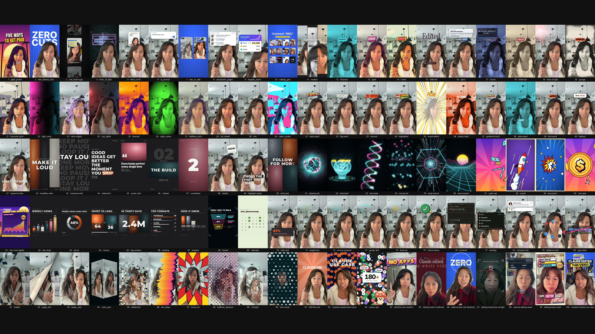
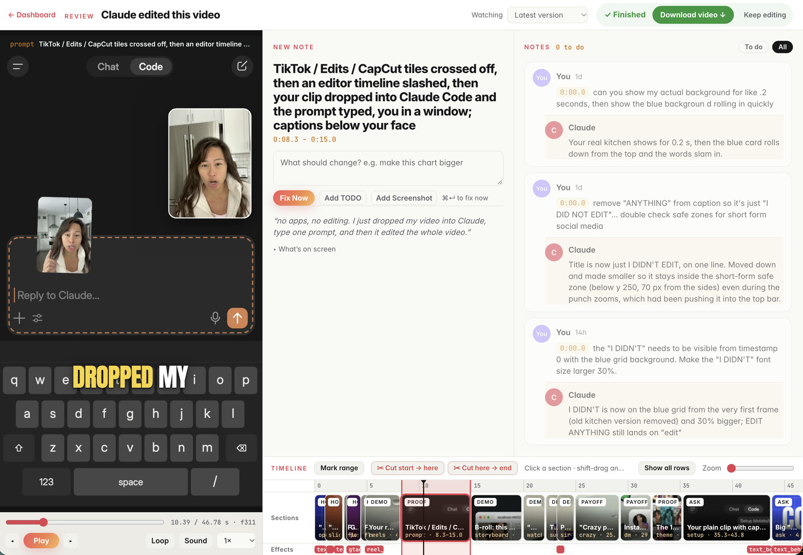
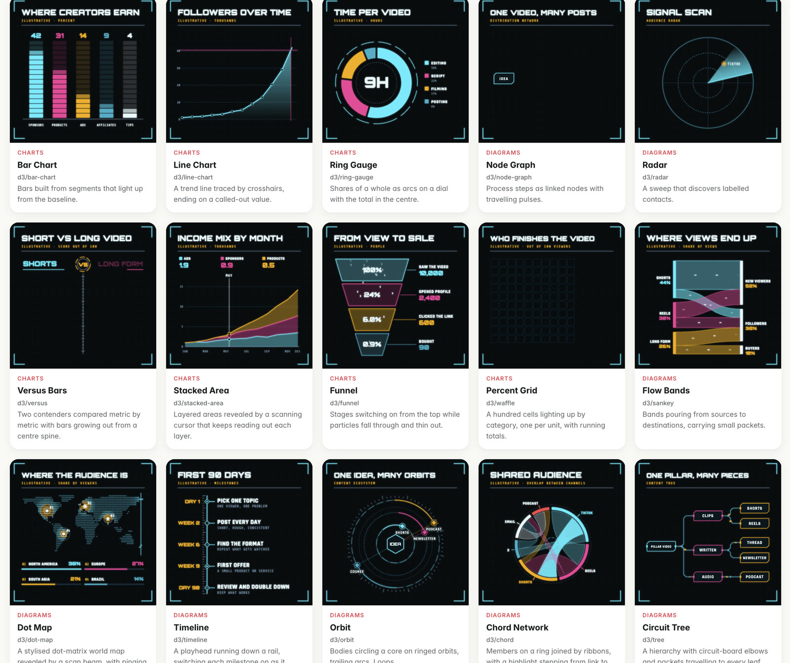
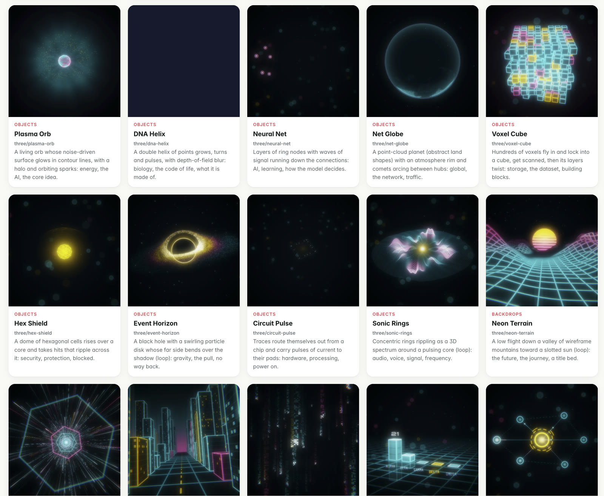
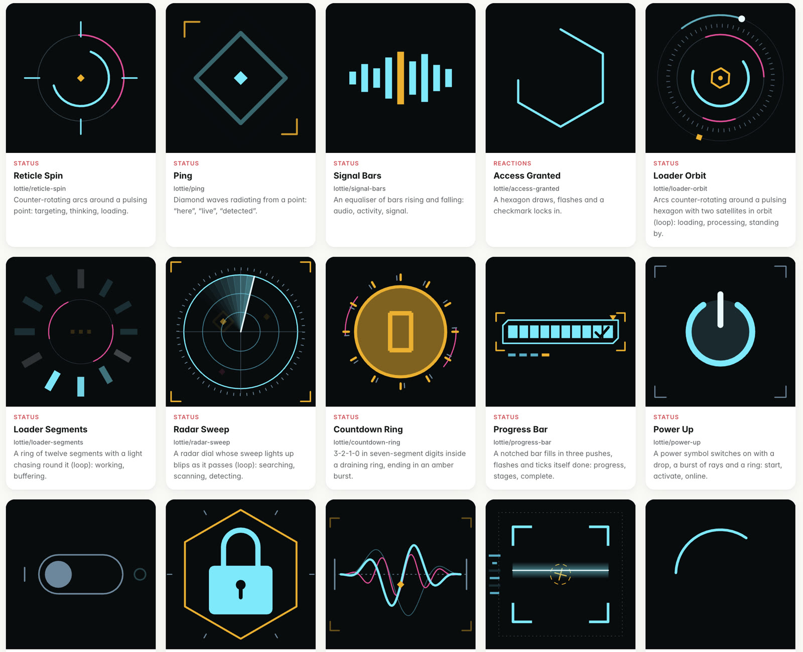

# ContentSkills

Make short vertical videos (Reels, TikTok, Shorts) by asking Claude in plain English.
Give it a video of you talking, or just a topic. Claude cuts it, adds captions, graphics, effects and sound,
and hands you a finished video.



## Install

Open the Terminal app (or the terminal inside Claude Code) and paste:

```sh
git clone https://github.com/blotato/contentskills ~/contentskills && cd ~/contentskills && npm run setup
```

That downloads the free voice and video tools (about 1.5 GB, once). Then open Claude Code in the `~/contentskills` folder.

> Not sure how? Open Claude Code and paste: **"setup blotato/contentskills"**. Claude clones it, installs what is
> missing (Node 22+, FFmpeg, uv) and opens your dashboard. AI agents: read `AGENTS.md` first; short guide at
> https://www.blotato.com/contentskills.md
>
> As a Claude Code plugin: `/plugin marketplace add blotato/contentskills`, then
> `/plugin install contentskills --marketplace blotato/contentskills`

## How to use it

1. Open Claude Code in the `~/contentskills` folder (the app's **Code** tab, or the terminal).
2. Drag your video into the chat, or just name a topic.
3. Say what you want:

```text
edit this video with the gta6 theme
edit this video based on this style: <paste Instagram reel URL>
make a faceless video on this topic: why you should stretch for two minutes after waking up
```

Claude writes a storyboard and sends you a link to it. Leave notes on any scene, or press **Make my video**. The
finished video opens on a review page where you mark changes; Claude applies them and re-makes only what changed.

Themes that ship: `modern` (the default), `minimal` and `gta6`. Next time, say **Open my dashboard.**

## What's inside

**Prompt-based video editor.** Watch the video, pause anywhere, type what should change.



**D3.js charts and diagrams**



**Three.js 3D scenes**



**2D animations**



## Writing and posting skills

These skills (formerly in `blotato-skills`) are in `skills/`:

| Skill | Say something like |
| --- | --- |
| content-coach | "I don't know what to post." The front door: runs the others. |
| brand-brief | "Set up my brand." One-time: your business, customer, call to action and voice. |
| post-writer | "Write me a post about X for Instagram." |
| post-grader | "Is this post any good?" Scores a draft and lists the top 3 fixes. |
| viral-hooks | "Give me a hook for X." 100 proven hook frameworks. |
| repurpose | "Turn this blog post into a week of content." |
| post-scheduler | "Schedule this to LinkedIn." Posts through Blotato. |
| generate | AI-generated clips through kie.ai (a paid service). For videos made free on your computer, just ask for a video. |

## How it works

Every video takes four steps.

1. **Ask.** Tell Claude what you want (examples below).
2. **Approve the plan.** Claude sends a link to a **storyboard**: a phone-size preview, one panel per scene.
   👍 the scenes you like, press ✎ Change on the ones you don't and say why. When it looks right, press **Make my video**.
3. **Fix.** Watch the video on its **review page**. Pause anywhere, type what's wrong (*"captions smaller"*), and press
   **Make a new version**. To cut a bit out, pause there and press **✂ Cut start → here** or **✂ Cut here → end**.
4. **Finish.** Press **Finish video ✓**. The video downloads.

The folder has five parts:

| Folder | What it is |
| --- | --- |
| `projects/` | Your videos, one folder each. |
| `library/` | The parts: themes (whole looks), effects, captions, charts, app screens, sounds and music. |
| `pipeline/` | The machine that builds a video: cut, find your face, plan, render, check. |
| `templates/` | Ready-made video formats you can reuse. |
| `style/` | Your personal look (colours, fonts, captions). It learns from your notes. |

### Best results: give Claude a reference style

Give Claude a **reference**: any Instagram Reel (or TikTok, or Short) whose look you like. Paste its
link and add it to your request:

> *Edit ~/Downloads/take1.mov in this style: https://www.instagram.com/reel/…*

Claude downloads the reel, goes through it frame by frame and measures it: the colour grade, the fonts, how the captions
look and where they sit, how the title is set, how often it cuts and how fast things land. Your video then gets that look.
Without a reference Claude uses the default theme.

- **Any reel works**, not only edits like yours: a podcast clip, a style reel, a tutorial. Pick it for the *look*.
- **Long reel?** Say which part matters: *"just analyze the first 15 seconds"*.
- **Instagram usually needs a login.** Claude will ask before using your browser's Instagram login (it stays on your
  computer). Or save the reel to Downloads and give Claude the file instead of the link.
- **A reference sets the style, nothing else**: colours, type, captions and pace. The other creator's graphics,
  logos and words are never reused. Your own rules still win (no text on your face, captions out of the app's buttons).
- **Keep it for next time**: *"make this my style"* turns the reference into your default look for every video.

## Things to ask Claude

**Start a video**

- *Edit ~/Downloads/take1.mov in this style: <reel link>*
- *Make a video from ~/Downloads/take1.mov* — your talking video (use your file's name and where it is; `~/Downloads` is
  your Downloads folder). Claude cuts the pauses and ums, adds captions and graphics on your words.
- *Make a 30-second video about 5 ways creators make money* — no camera: Claude writes the script, adds a free voice and a visual for every line.
- *Make a video from ~/Downloads/take1.mov in the gta6 theme* — pick a whole look. Themes: modern (the default),
  minimal and gta6.

**Add something specific** (names are under each tile in the showcase)

- *Put text_behind_slice on the hook* — big words behind you, sliced on the beat.
- *Use gta6_poster when I say "five ways"* — turns you into a game poster for a moment.
- *Show feed_scroll when I mention my best reels*
- *Add a bar chart of the numbers I say at 0:20*
- *Glitch on every cut* · *cel shade the whole video* · *add a vhs look to the intro*

**Fix things** (or type these as notes on the review page)

- *Captions smaller and lower* · *This card covers my face* · *Too many graphics in the middle* · *Make the hook punchier*

**Your look**

- *Make my style from this reel: <link>* — Claude takes its colours, type and pace as a style reference (never its graphics or words).
- *Hate the blue, never use it again* — notes about taste are remembered for every next video.

**Ready-made formats**

- *Make an effects showcase: me typing /effect text-behind-slice, /effect reel-flythrough … and the result of each*
- *Put my raw clip and the edited video side by side*

## Good to know

- **Free by default.** The voice, transcription and effects run on your computer. Paid voices (ElevenLabs) and posting
  are never used without asking you first.
- **Nothing is rendered until you approve the storyboard.**
- **Every video is checked** before you see it: no text on your face, nothing hidden under TikTok's or Instagram's
  buttons and captions, steady loudness, no frozen or black frames.
- **Old versions are kept.**
- **Browse everything** on the dashboard's **Library** and **Gallery** pages. It all plays live.

## For developers

```sh
npm run setup            # once: installs the pipeline's tools into .tools/ (about 1.5 GB)
npm run dashboard        # http://localhost:4600/dashboard/ ,  /pipeline/draft/  and  /pipeline/review/
```

Needs Node 22+, FFmpeg and `uv`. There is no `npm install`. The dashboard and rough drafts work
without setup; setup adds what narration, transcription, effects and video output need: three Python
environments, the Kokoro voice model, the Whisper `small.en` speech model and a headless Chrome.

## Your settings

Nothing about you is written into the code. Two files hold it, and neither is committed:

| File | What it holds |
| --- | --- |
| `settings/user.json` | Who you are and how you like your videos. Copy `settings/user.example.json` and edit it, or just tell Claude ("my handle is @…", "make my voice a little louder") and it writes the file. |
| `style/profile.json` | Your look: colours, fonts, captions, grade and tastes learnt from your review notes. `style/profile.example.json` shows the shape; `npm run style` writes it from a reel you like. |

`settings/user.json` only needs the values that differ from `settings/defaults.json`:

```json
{
  "me": {"name": "Alex Rivera", "handle": "alexmakes", "role": "Founder · Example Co", "keyword": "GUIDE"},
  "audio": {"voiceLufs": -13},
  "style": {"cookiesBrowser": "chrome"}
}
```

- `me` fills in every graphic that shows a person: the name plate, the Instagram comment-to-DM card, the end card's
  "Comment …" line. A storyboard can still override any of them for one video.
- `audio.voiceLufs` is how loud your voice is made in every video (default −14 LUFS). `audio.music` and `audio.effects`
  set how far under your voice the music and sound effects sit.
- `captions.bottom` is where you like the caption line; `style.cookiesBrowser` is the browser whose Instagram login
  `npm run style -- from <url>` may use (empty until you choose one).

Set `CONTENTSKILLS_SETTINGS=/path/to/file.json` to use a different settings file for one command.

## Server and editor

```sh
npm run dashboard                 # starts the local server on http://localhost:4600 (Ctrl+C stops it)
npm run link                      # prints the address; if another program has 4600 the server takes the next free port
```

One small server (`dashboard/serve.mjs`, no dependencies) serves three pages. Open them in any browser:

| Page | Address | What it is for |
|---|---|---|
| Master dashboard | `http://localhost:4600/dashboard/` | Every piece of a theme, playing live; switch themes, scrub, look at captions, effects and transitions. |
| Editor (rough draft) | `http://localhost:4600/pipeline/draft/?project=<name>` | The storyboard playing live, nothing rendered. Shot videos: pick and mark candidates (draft / usable / rejected, **use this one**), **Preview the cut**. Footage videos: the clip with its graphics and captions over it, and the list of graphics to jump to. Without `?project=` it lists the projects. |
| Review | `http://localhost:4600/pipeline/review/?project=<name>` | The finished `out/cut.mp4` (or an earlier version) with a timeline of sections and lanes; select a range and leave a mark (change / cut / keep / question). See **The review page** below. |

How it fits together:

- **Edit the storyboard, reload the editor.** The editor reads `projects/<name>/storyboard.json` on every load, so a
  change (by hand or by the agent) shows on reload. Marks made in the editor are written back into `storyboard.json`;
  marks made on the review page go to `projects/<name>/review.json`, which the agent reads with `npm run review <name>`.
- **The editor is what gets rendered.** `npm run make` steps this same page frame by frame in headless Chrome, so what
  the editor shows is what the video shows, captions included (they place themselves off the face and inside the safe
  zone). Colour grade, effects, transitions and sound effects are added by the make, not shown in the editor.
- **Safe to leave running.** It listens on 127.0.0.1 only, serves only `dashboard/`, `library/`, `pipeline/` and
  `projects/` (never dotfiles or `.env.local`), and accepts writes only from its own pages.
- The make and the quality check start their own private copy of the server on a free port, so they work whether or
  not `npm run dashboard` is running.

## What is where

| Folder | What it is |
| --- | --- |
| `library/` | The pieces, organised into themes (unified styles). |
| `dashboard/` | The master dashboard: shows every piece of a theme, live. Also the local server. |
| `AGENTS.md` | How an agent should work here (`CLAUDE.md` and `GEMINI.md` only import it): make videos automatically, keep graphics off faces, one base theme per video. |
| `skills/make-video/SKILL.md` | The agent's playbook: workflows, the storyboard standard, sections and fast re-makes, the review loop, pitfalls, commands. |
| `skills/quality-check/SKILL.md` | The quality-check loop: what `npm run qa` checks and how to fix each failure (see Quality checks in `docs/REFERENCE.md`). |
| `pipeline/` | The three stages that turn a storyboard into a video, and the review page (`pipeline/review/`). |
| `projects/` | One folder per video. A project is a `storyboard.json`; output lands in `out/`, review marks in `review.json`, and what a re-make can reuse in `.cache/` (hidden, git-ignored, safe to delete). |
| `gallery/` | The showcase sheet and finished reels, shown on the dashboard's Gallery page. See `gallery/README.md`. |
| `templates/` | Reusable video structures (effects showcase, side-by-side compare). `npm run template` builds a project from a short spec. See `templates/README.md`. |
| `style/` | The user's look (`profile.json`: colours, fonts, captions, grade, learned preferences) and looks taken from reference reels (`references/`), laid over any theme. |
| `settings/` | Your settings: `defaults.json` for everyone, your own `user.json` (git-ignored) on top. See "Your settings". |
| `.tools/` | Installed by `npm run setup`. Safe to delete and reinstall. |
| `.env.local` | Your ElevenLabs API key (paid voices, `"provider": "elevenlabs"`). Not served by the dashboard; keep it out of version control. |

## The library: themes

A **theme** is one unified style, so different themes make different kinds of videos while every
graphic inside a video matches. Each theme lives in `library/themes/<theme>/` with one folder per
category and a `catalog.json` in each. The dashboard switches between themes, and a storyboard
names its theme (`"theme": "gta6"`).

| Theme | Look |
| --- | --- |
| `modern` | Fast editorial opener: near-black charcoal canvas around full-bleed vertical pictures, colour only from the footage; staggered strips, mosaics, slot reveals. The default. |
| `gta6` | Comic-panel coastal sunset, inspired by GTA VI cover art: angled panels with pale gutters, pink-violet-orange skies, ink outlines, chunky gradient lettering. |
| `minimal` | Quiet product-launch explainer: one hero object on near-black (or warm light grey), the caption is one line at the top revealed word by word (bold, italic-serif or blue-highlight emphasis), Apple-like cards, chips, gauges and ticking numbers. Full-frame `scenes/` timed to the voice. |

What each theme contains (overlays live in `panels/` in gta6, `scenes/` in minimal, `overlays/` elsewhere; the dashboard calls them all Overlays). The 11 Effects (set pieces) are shared by every theme and not counted here:

| Theme | Overlays | Text animations | Filters | Transitions | Fonts | Captions | D3 | Three.js | Lottie | Total |
| --- | --- | --- | --- | --- | --- | --- | --- | --- | --- | --- |
| `modern` | 15 | 19 | 24 | 11 | 12 | 6 | 10 | 6 | 12 | 115 |
| `gta6` | 14 | 19 | 29 | 11 | 23 | 6 | 12 | 8 | 13 | 135 |
| `minimal` | 18 | – | – | 4 | 4 | 1 | – | – | – | 27 |

- **Text animations** (folder `text/`) are the same 19 pieces in every theme that has them (11 full-frame title cards, 8
  footage overlays), drawn in that theme's style, so a storyboard can switch themes and keep its text.
- **Filters** (folder `effects/`) and **transitions** can be theme-specific: `effects/theme_effects.py` and
  `transitions/theme_transitions.py` add to the shared engines without editing them.
- **Lighting** (group "Lighting" in every theme's filters): 9 relighting setups for footage of a person,
  spotlight, flashlight, silhouette, projector, neon, golden_hour, under_light, low_key and rim (`light_<name>`), in `library/_shared/lighting.py`. Each frame finds the face (YuNet) and
  cuts out the person (PP-HumanSeg), so the light lands on them. Use like any effect:
  `{"footage": {"look": {"name": "light_rembrandt", "amount": 0.8}}}` or a timed effect per section.
  Previews: `.tools/venv-effects/bin/python library/_shared/lighting_previews.py`.
- **Effects vs filters.** The dashboard's **Effects** section (the same in every theme; catalog `library/_shared/signature/catalog.json`, id `moments`) holds:
  the signature set pieces, in `library/_shared/signature.py` — `text_behind_slice`, `gta6_poster`, `reel_flythrough`,
  `ai_prompt`, `edit_preview`, `raw_vs_edit`, `feed_scroll`, `storyboard_pages`, `insights_zoom`, `catalog_grid`, `lines_of_light`.
  Each theme's own effects catalog is shown as **Filters**: a filter changes the shot's look (any length, an amount
  dial); an effect brings its own content (title, cards, reels, a background) and its own few-second timeline, and
  takes over the frame. In a storyboard both are entries in `effects`. Use one as an effect entry spanning
  the moment, with options in `"props"`, `"where": "all"` and `"amount": 1`. The same file holds two looks, `cop_lights`
  (group Lighting) and `color_grade` (group Look), listed in every theme's filters. The person is found with the
  lighting models. Previews and catalogs: `.tools/venv-effects/bin/python library/_shared/signature_previews.py`.
- **Shared by all themes:** `library/voiceover/`,
  `library/_shared/` (piece loader, caption engine, effects and transition engines, sample clip)
  and `library/models/` (face detector, person segmenter).

Every animated piece follows one contract, which is what lets the dashboard, the rough-draft
player and the video combiner all use the same files:

```js
export const meta = {duration: 3.2};          // seconds; live: true means it keeps moving while on screen
export const defaults = {title: '…'};          // optional: data the storyboard may override
export function mount(el, props) {             // draw into el
  return {seek(t) { /* show exactly what the piece looks like at t seconds */ }};
}
```

`seek(t)` depends only on `t` — no timers, no random numbers — so a piece can be looped, scrubbed,
or captured frame by frame and always looks the same.

**To add a piece:** drop the file in the theme's category folder and add one entry to that folder's
`catalog.json`. **To add a theme:** follow `library/themes/BUILDING-A-THEME.md`.

**UI kits** (`library/ui/<name>/`) draw a real app's screens rather than a style, and any video can use them on top
of its base theme. `ui/claude` is the Claude mobile app (Code tab, dark): `ui.js` is the drawing kit (colours, Inter
Tight, top bar with the Chat | Code toggle, iOS keyboard with key pop-ups, icons, the spark), and
`overlays/` holds the screens: `composer`, `chat`, `stamp`, `greeting`, `endcard` (see its `catalog.json`). Use one with
`{"piece": "overlays/composer", "theme": "ui/claude", "props": {...}}`.

## Reference

Every storyboard field, the pipeline commands, the two worked walkthroughs, the review page, transitions, quality
checks and recipes are in [docs/REFERENCE.md](docs/REFERENCE.md).

## Windows and Linux

**Windows**

- Use the Claude desktop app's **Code** tab, as above.
- If "Set me up" can't install a tool on its own, open **PowerShell** and run:
  `winget install OpenJS.NodeJS.LTS Gyan.FFmpeg astral-sh.uv`, then close and reopen the Claude app and say **Set me up** again.

**Linux**

- There is no Claude desktop app for Linux. Use Claude Code in the terminal instead: install it with
  `curl -fsSL https://claude.ai/install.sh | bash`, then go into this folder (`cd` to it), type `claude` and say **Set me up**.
- If a tool is missing, install it with your package manager, e.g. on Ubuntu: `sudo apt install ffmpeg nodejs`
  (Node must be version 22 or newer) and `curl -LsSf https://astral.sh/uv/install.sh | sh`.
- The smooth shader transitions need OpenGL, which every desktop has. On a server without a screen, ask Claude to use
  other transitions.

## License

The code is licensed under the GNU Affero General Public License, version 3 only (`AGPL-3.0-only`); see [LICENSE](LICENSE).
Fonts, models and other third-party files keep their own licences. The licence covers the code, not the videos you make
with it, and it gives no rights in media you bring yourself.
